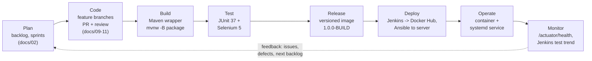

# 2. Agile plan

Single-developer project run with lightweight Scrum-style sprints. Timebox: 4 one-week
sprints, daily 5-minute stand-up (self-check against the board), sprint review with a demo.

## Team & roles

| Role | Responsibility |
|------|----------------|
| Developer (also Scrum master) | implementation, tests, pipeline |
| Stakeholder / reviewer | accepts demo each Friday, prioritises backlog |

## Estimation

Story points: Fibonacci (1, 2, 3, 5, 8). Velocity assumed 20 points/sprint; re-planned after
sprint 1 (actual 22).

## Backlog (epics broken into stories)

| ID | Story | Points | Sprint |
|----|-------|--------|--------|
| S1 | As a user I see a dashboard with total/expired/expiring/valid counts | 5 | 1 |
| S2 | As a developer I compute status from expiry date and threshold | 3 | 1 |
| S3 | As a user I can add a certificate with validation | 5 | 1 |
| S4 | Demo dataset seeded at startup | 2 | 1 |
| S5 | As a user I can edit and delete certificates (with confirmation) | 5 | 2 |
| S6 | As a user I can search, filter, sort and paginate the list | 8 | 2 |
| S7 | As a user I see a detail page with days remaining and alerts | 3 | 2 |
| S8 | Error pages and friendly validation feedback | 3 | 2 |
| S9 | Unit, service and repository test suites (target >= 30 tests) | 5 | 3 |
| S10 | MockMvc integration tests for every route | 5 | 3 |
| S11 | Selenium journeys for the main user flows | 8 | 3 |
| S12 | Maven wrapper, profiles, CI-ready build | 3 | 3 |
| S13 | Docker image + compose with persistent data volume | 5 | 4 |
| S14 | Jenkins declarative pipeline (test -> package -> image -> deploy) | 5 | 4 |
| S15 | Ansible provisioning (Docker, app, systemd) | 5 | 4 |
| S16 | Documentation set + final validation report | 5 | 4 |

Total: 78 points across 4 sprints.

## Sprint 1 - walking skeleton

- Goal: app starts, dashboard renders with correct counts from seeded data.
- Increment: `mvnw spring-boot:run` -> dashboard with live counts; status calculator fully tested.
- Done = unit tests green, manual smoke of `/` and `/certificates/new`.

## Sprint 2 - full CRUD

- Goal: manage certificates end to end.
- Increment: create/edit/delete + list with search/filter/sort/pagination, detail and exceptions
  pages, error handling.
- Done = all routes exercised by MockMvc tests.

## Sprint 3 - quality gates

- Goal: confidence to automate.
- Increment: full JUnit/Mockito/AssertJ coverage of business rules, MockMvc integration suite,
  5 Selenium journeys behind the `ui` Maven profile, wrapper-based build usable by CI.
- Done = `mvnw -B test` and `mvnw -B test -Pui` both green locally.

## Sprint 4 - delivery

- Goal: build once, deploy anywhere.
- Increment: Dockerfile/compose, Jenkinsfile, Ansible playbooks, docs, demo script.
- Done = `docker build` + container health check verified; every documented command re-run.

## Risks & mitigations

| Risk | Mitigation |
|------|------------|
| Browser tests flaky | wait on stable `data-testid` anchors, ignore stale-element races, headless mode, screenshots on failure |
| Locale-dependent date rendering breaks `<input type="date">` | fixed `yyyy-MM-dd` `@DateTimeFormat` + boundary tests |
| Demo data counts drifting from docs/UI tests | demo dataset generated from `LocalDate.now()` offsets; counts asserted in both MockMvc and Selenium tests |
| Jenkins/Ansible unavailable on the dev machine | every command verified locally first; playbooks reviewed statically and documented as unexecuted |

## Definition of done

Story is done when: code + tests merged to `main`, `mvnw -B test` green, docs updated, demo
performed to the stakeholder.

## Task board (Kanban)

The board has five columns and a WIP limit of **1** per active column (single developer, so
only one story is in `In Progress` at a time). Cards are the stories from the backlog above;
each card carries its story-point estimate and links to its branch and commit.

```
+-------------+-------------+-------------+-------------+-------------+
|  Backlog    |   To Do     | In Progress |   Review    |    Done     |
|             | (this       |   (WIP: 1)  | (WIP: 1)    |             |
|             |  sprint)    |             |             |             |
+-------------+-------------+-------------+-------------+-------------+
```

**Board snapshot at the end of Sprint 4** (all columns drained except `Done`; `Review` was the
sprint-review demo):

| Column | Cards |
|--------|-------|
| Backlog | - (empty; next-sprint ideas captured as GitHub issues) |
| To Do | - |
| In Progress | - |
| Review | - |
| Done | S1..S16 (all stories accepted) |

Movement rules: a card moves `To Do -> In Progress` only when the previous card has left
`In Progress` (WIP limit 1); it moves `In Progress -> Review` only when `mvnw -B test -Pui` is
green locally; it moves `Review -> Done` only after the sprint-review demo and the DoD are met.

## DevOps workflow (lifecycle)

The project is a complete DevOps loop; every stage maps to a concrete tool and artifact in the
repository.



| Stage | Tooling | Evidence |
|-------|---------|----------|
| Plan | Markdown backlog + Kanban board | this document |
| Code | Git + GitHub, branch naming, PR template | `docs/09`, `docs/10`, `.github/` |
| Build | Maven Wrapper 3.9.9, Java 21 | `mvnw -B package`, Jenkinsfile |
| Test | JUnit 5 / Mockito / AssertJ, Selenium 4.27 | `docs/14`, `docs/15`, Jenkins JUnit report |
| Release | versioned Docker image `1.0.0-${BUILD_NUMBER}` | `docs/16`, Docker Hub tags |
| Deploy | Jenkins pipeline + Ansible | `docs/17`, `docs/18`, `Jenkinsfile` |
| Operate | Docker container / Ansible systemd unit | `docs/16`, `docs/18` |
| Monitor | Spring Actuator health, Jenkins trends | `/actuator/health`, `docs/19` |
